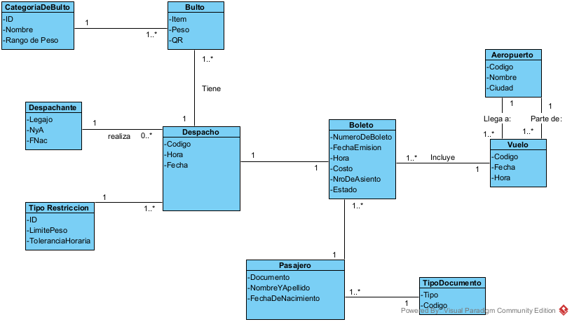
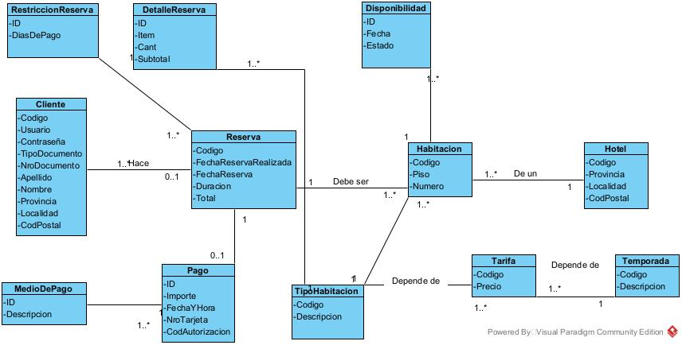
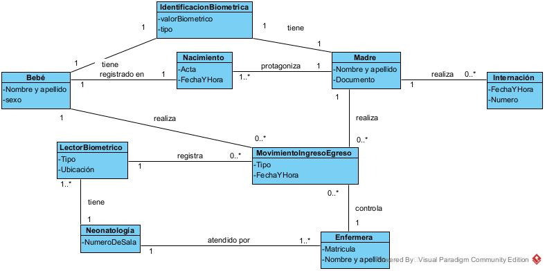

# UNLaM — Systems Analysis Models

Selected academic diagrams by **Federico Pucci** for Análisis de Sistemas at Universidad Nacional de La Matanza. These exercises explore domain modeling, object-oriented analysis, activities and state transitions for course case studies.

| Case study | Published diagrams | Concepts |
| --- | --- | --- |
| [Air Patagonia](diagrams/air-patagonia/AirPatagoniaMDOM.png) | Domain model | Passengers, tickets, flights, dispatch, baggage and restrictions |
| [Cadena Hotelera](diagrams/cadena-hotelera/CadenaHoteleraMDOM.jpg) | Domain model | Hotels, rooms, reservations, availability, payments and seasonal rates |
| [Centro Médico](diagrams/centro-medico) | Domain, analysis classes, activity and state diagrams | Neonatal access, biometric identification, staff and movement records |

## Air Patagonia — domain model

## Cadena Hotelera — domain model

## Centro Médico

Additional views:

- [Analysis classes](diagrams/centro-medico/CentroMedicoAOO.jpg)
- [Neonatal discharge activity](diagrams/centro-medico/CentroMedicoDAC.jpg)
- [Biometric reader states](diagrams/centro-medico/CentroMedicoDES.jpg)

## Authorship and publication scope

The author confirmed creating the selected models as academic work. Case descriptions and teaching templates originate from the course. These diagrams are modeling exercises, not implemented or deployed applications.

The source archive uses Visual Paradigm `.vpp` projects. Several containers include unrelated case studies and class templates alongside the selected work; this repository publishes only the confirmed diagram exports. The Air Patagonia image was exported from a temporary copy using Visual Paradigm CE 18.1; existing JPG exports were retained for the other cases. Local native files were not changed. Visual Paradigm attribution remains visible in the images.

The six published images were visually reviewed and their links checked. Original JPG resolution is preserved. This review does not claim that the models have been formally graded or validated against every course requirement.

See [source notes](SOURCES.md) and my [software engineering portfolio](https://github.com/FedePucci1/portfolio-index).
